## 🚀 Práctica Guiada: Preparación y Evaluación de Imágenes para Visión Artificial

> **Nivel:** Básico – Principiante (Desde cero)  
> **Duración:** 2 horas  
> **Asignatura:** Soluciona problemas de Visión Artificial  
> **Especialidad:** Inteligencia Artificial  
> **Semestre:** 3º de Preparatoria  
> **Herramientas:** Python, Visual Studio Code, OpenCV y NumPy.
# Oscar Flores NC = 1389
## Resultados

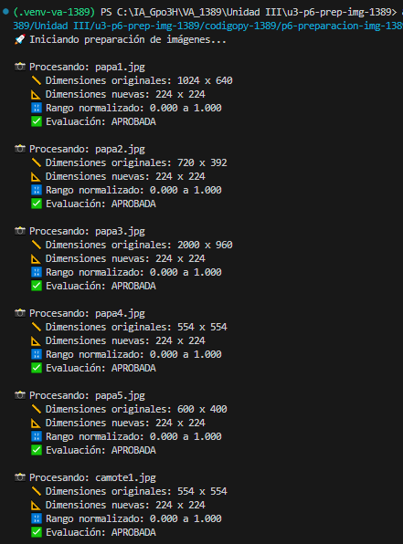
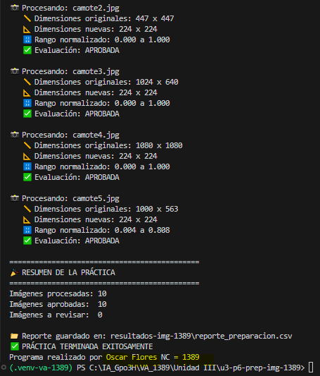
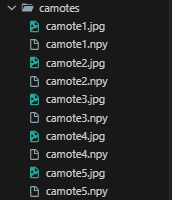
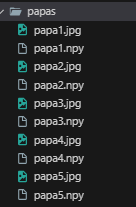
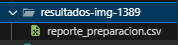
# Papas
### papa 1
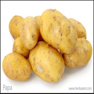
### papa 2
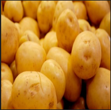
### papa 3
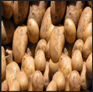
### papa 4
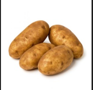
### papa 5
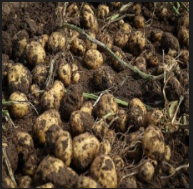
# Camote 
### camote 1
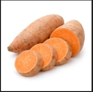
### camote 2
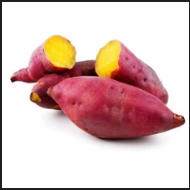
### camote 3
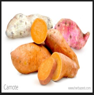
### camote 4
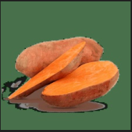
### camote 5
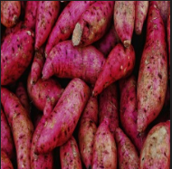